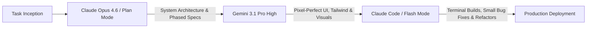
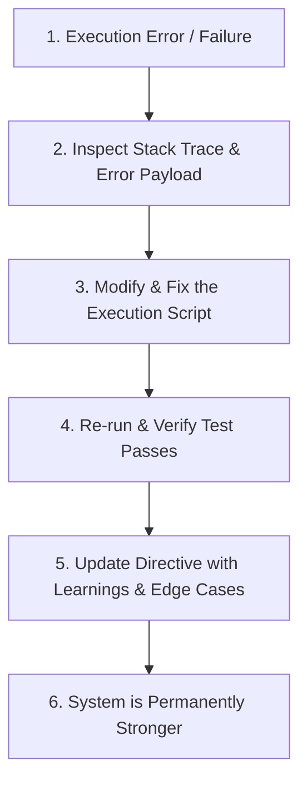
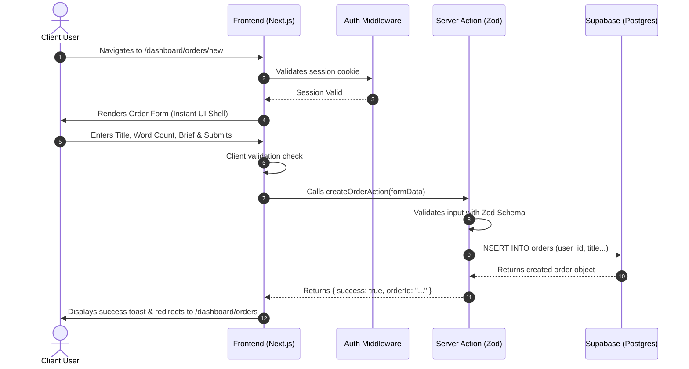
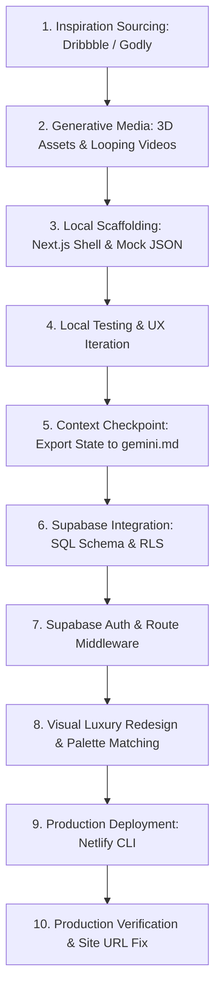

# The Master Vibe Coding Reference Guide
### The Comprehensive Operating System, Architecture, Documentation & Workflow Blueprint for AI-Assisted Software Development

---

## Table of Contents
1. [Core Philosophy & Operating Mindset](#1-core-philosophy--operating-mindset)
   - [The Creative Technologist Paradigm](#the-creative-technologist-paradigm)
   - [The Probabilistic vs. Deterministic Law ($0.9^5 \approx 59\%$)](#the-probabilistic-vs-deterministic-law)
   - [The Gold Miner Mindset (Navigating Initial Sludge)](#the-gold-miner-mindset-navigating-initial-sludge)
   - [Simplicity as a Moat](#simplicity-as-a-moat)
   - [Economics & Business Leverage](#economics--business-leverage)
2. [The Vibe Coding Tech Stack & Tool Selection Matrix](#2-the-vibe-coding-tech-stack--tool-selection-matrix)
   - [Tool Selection Matrix](#tool-selection-matrix)
   - [The Recommended Production Full-Stack](#the-recommended-production-full-stack)
   - [Multi-Model Arbitrage Strategy](#multi-model-arbitrage-strategy)
   - [Voice Dictation & Agent Inspector Feedback Loop](#voice-dictation--agent-inspector-feedback-loop)
3. [Pre-Build Planning & Scoping Framework](#3-pre-build-planning--scoping-framework)
   - [The 8-Step Rapid App Planning Formula](#the-8-step-rapid-app-planning-formula)
   - [The 5 Critical Pre-Coding Questions](#the-5-critical-pre-coding-questions)
   - [User, Competitor & Technical Feasibility Research](#user-competitor--technical-feasibility-research)
   - [Ruthless Scoping: MVP vs. Non-Goals](#ruthless-scoping-mvp-vs-non-goals)
4. [The 3-Layer Architecture for Agent Reliability](#4-the-3-layer-architecture-for-agent-reliability)
   - [Layer 1: Directive (SOPs in Markdown)](#layer-1-directive-what-to-do)
   - [Layer 2: Orchestration (The AI Agent as Intelligent Router)](#layer-2-orchestration-decision-making)
   - [Layer 3: Execution (Deterministic Scripts)](#layer-3-execution-doing-the-work)
   - [Intermediates (`.tmp/`) vs. Deliverables](#intermediates-vs-deliverables)
   - [The Self-Annealing Loop](#the-self-annealing-loop)
5. [Universal Project Structure & Documentation Hierarchy](#5-universal-project-structure--documentation-hierarchy)
   - [The Two-Tier Strategy: Minimal vs. Production Enterprise](#the-two-tier-strategy)
   - [Full Enterprise Directory Tree](#full-enterprise-directory-tree)
   - [Agent Configuration Mirroring (`AGENTS.md`, `CLAUDE.md`, `GEMINI.md`)](#agent-configuration-mirroring)
6. [The Complete Master Markdown Templates Suite](#6-the-complete-master-markdown-templates-suite)
   - [01. `PRD.md` — Product Requirements Document](#01-prdmd--product-requirements-document)
   - [02. `ARCHITECTURE.md` — System Architecture](#02-architecturemd--system-architecture)
   - [03. `DESIGN_SYSTEM.md` — Visual Language & Tokens](#03-design_systemmd--visual-language--tokens)
   - [04. `DATABASE.md` — Data Model & RLS Policies](#04-databasemd--data-model--rls-policies)
   - [05. `SECURITY.md` — Security Guidelines & RBAC](#05-securitymd--security-guidelines--rbac)
   - [06. `CODE_STYLE.md` — Coding Conventions & Standards](#06-code_stylemd--coding-conventions--standards)
   - [07. `TESTING.md` / `TEST_PLAN.md` — Verification Strategy](#07-testingmd--test_planmd--verification-strategy)
   - [08. `AGENTS.md` / `gemini.md` — Master Agent Directives](#08-agentsmd--geminimd--master-agent-directives)
   - [09. `UX_FLOWS.md` — Detailed Navigation & Journey Maps](#09-ux_flowsmd--detailed-navigation--journey-maps)
   - [10. `API.md` — API Contracts & Endpoint Specifications](#10-apimd--api-contracts--endpoint-specifications)
   - [11. `TASKS.md` — Phased Implementation Checklist](#11-tasksmd--phased-implementation-checklist)
   - [12. `DECISIONS.md` — Architecture Decision Records (ADR)](#12-decisionsmd--architecture-decision-records-adr)
   - [13. `MEMORY.md` — Live Project State & Scratchpad](#13-memorymd--live-project-state--scratchpad)
   - [14. `.env.example` — Environment Secrets Blueprint](#14-envexample--environment-secrets-blueprint)
7. [Universal AI Project Brain Setup (Existing Codebases & State Freezing)](#7-universal-ai-project-brain-setup-existing-codebases--state-freezing)
   - [The 8 Critical Rules for Project Onboarding (Zero Code Mutation)](#the-8-critical-rules-for-project-onboarding)
   - [The `ai/` Documentation Quad: Instructions, Decisions, Known Issues, Current State](#the-ai-documentation-quad)
   - [Verification Protocol & Audit Report](#verification-protocol--audit-report)
8. [End-to-End Feature Development Workflow & Slicing](#8-end-to-end-feature-development-workflow--slicing)
   - [The Master 10-Step Vibe Coding Design Loop](#the-master-10-step-vibe-coding-design-loop)
   - [Vertical Slices vs. Horizontal Layers](#vertical-slices-vs-horizontal-layers)
   - [The 9-Step Professional Feature Loop](#the-9-step-professional-feature-loop)
   - [Context Window Checkpointing (`gemini.md` State Exporting)](#context-window-checkpointing)
   - [Task Granularity & Prompt Sizing](#task-granularity--prompt-sizing)
9. [UI/UX Excellence, Generative Media & Luxury Front-End Design](#9-uiux-excellence-generative-media--luxury-front-end-design)
   - [Eradicating Generic AI Aesthetics](#eradicating-generic-ai-aesthetics)
   - [The 6-Question Cinematic Design Questionnaire](#the-6-question-cinematic-design-questionnaire)
   - [Structural Typologies & Layout Archetypes](#structural-typologies--layout-archetypes)
   - [Visual Polish Rules: Typography, 1px Subtle Borders & Instant Tables](#visual-polish-rules)
   - [Generative 3D Asset & Video Loop Pipeline (Imagen + Veo 3)](#generative-3d-asset--video-loop-pipeline)
10. [The 80/20 Security Vulnerabilities & Audit Protocol](#10-the-8020-security-vulnerabilities--audit-protocol)
    - [The 5 Fatal Vibe Coding Vulnerabilities](#the-5-fatal-vibe-coding-vulnerabilities)
    - [Supabase Production SQL Schema with Complete RLS](#supabase-production-sql-schema-with-complete-rls)
    - [Server-Side Validation & Next.js Route Middleware](#server-side-validation--nextjs-route-middleware)
    - [The Master Security Audit Prompt](#the-master-security-audit-prompt)
11. [Testing, Structured Debugging & Quality Assurance](#11-testing-structured-debugging--quality-assurance)
    - [The Testing Pyramid & Verification Ladder](#the-testing-pyramid--verification-ladder)
    - [Structured Root-Cause Debugging Protocol](#structured-root-cause-debugging-protocol)
    - [Automated E2E Testing with Playwright](#automated-e2e-testing-with-playwright)
    - [Pre-Flight Verification Checklist](#pre-flight-verification-checklist)
12. [Deployment, Production Operations & Post-Launch Monitoring](#12-deployment-production-operations--post-launch-monitoring)
    - [The Deployment Pipeline: Local → Preview → QA → Production](#the-deployment-pipeline)
    - [Zero-Config Deployment via Netlify CLI & Vercel](#zero-config-deployment-via-netlify-cli--vercel)
    - [The Production Auth Callback Fix (Crucial Supabase Setup)](#the-production-auth-callback-fix)
    - [Multi-Environment Configuration (.env.local vs. Prod)](#multi-environment-configuration)
    - [Production QA & Post-Launch Monitoring Lifecycle](#production-qa--post-launch-monitoring-lifecycle)
13. [Master Prompts & Template Library](#13-master-prompts--template-library)
    - [Prompt 1: Project Kickoff & Context Ingestion](#prompt-1-project-kickoff--context-ingestion)
    - [Prompt 2: Idea to Complete PRD & Documentation Generator](#prompt-2-idea-to-complete-prd--documentation-generator)
    - [Prompt 3: Full-Stack Architecture Decomposition (Claude Opus 4.6)](#prompt-3-full-stack-architecture-decomposition)
    - [Prompt 4: The 6-Part Structured Feature Implementation Prompt](#prompt-4-the-6-part-structured-feature-implementation-prompt)
    - [Prompt 5: Cinematic Landing Page Q&A Prompt](#prompt-5-cinematic-landing-page-qa-prompt)
    - [Prompt 6: Visual Overhaul & Screenshot Steering Prompt](#prompt-6-visual-overhaul--screenshot-steering-prompt)
    - [Prompt 7: Structured Root-Cause Bug Diagnosis Prompt](#prompt-7-structured-root-cause-bug-diagnosis-prompt)
    - [Prompt 8: Pre-Release Code Review Prompt](#prompt-8-pre-release-code-review-prompt)
    - [Prompt 9: Master 80/20 Security Audit Prompt](#prompt-9-master-8020-security-audit-prompt)
    - [Prompt 10: State Checkpointing & Context Preserver Prompt](#prompt-10-state-checkpointing--context-preserver-prompt)
14. [Quick Reference Cheat Sheet, Keybindings & Commands](#14-quick-reference-cheat-sheet-keybindings--commands)
    - [IDE Hotkeys (Antigravity & Cursor)](#ide-hotkeys)
    - [Context Injection Syntax (@ Mentions & Slash Commands)](#context-injection-syntax)
    - [Essential Terminal Commands & Scaffolding Scripts](#essential-terminal-commands--scaffolding-scripts)
    - [Git Branching & Rollback Safety Net](#git-branching--rollback-safety-net)

---

# 1. Core Philosophy & Operating Mindset

### The Creative Technologist Paradigm
Vibe coding is not typing code blindly while hoping an AI guesses right. It is a fundamental shift in software creation: **you transition from a syntax typist to a Creative Technologist, Product Architect, and Executive Director**.

The AI model writes thousands of lines of code in seconds. Your role is:
- **Steering high-level architectural intent** and user requirements.
- **Establishing strict guardrails, contracts, and behavioral boundaries**.
- **Delivering high-bandwidth, multimodal feedback** (voice dictation, reference comps, UI screenshots).
- **Enforcing ruthless security and aesthetic standards**.

```
+-----------------------------------------------------------------------------------+
|                           THE VIBE CODING OPERATING MODEL                         |
|                                                                                   |
|  HUMAN ROLE: Creative Technologist & Director                                      |
|  - Defines Product Vision, Scope & Business Logic                                 |
|  - Curates Design Archetypes & UX Quality                                         |
|  - Enforces Architecture & Security Boundaries                                    |
|  - Guides Model Iterations via Voice & Screenshots                                |
|                                                                                   |
|                                       ↕                                           |
|                                                                                   |
|  AI ROLE: High-Speed Implementer & Autonomous Agent                               |
|  - Generates Code, Boilerplate, Types & Tests                                     |
|  - Executes Terminal Commands & Browser Tests                                     |
|  - Translates High-Level Specs into Pixel-Perfect Layouts                         |
|  - Proposes Schema Migrations & API Routes                                        |
+-----------------------------------------------------------------------------------+
```

### The Probabilistic vs. Deterministic Law
Large Language Models (LLMs) are **probabilistic token prediction engines**. Most business logic, data processing, and API integrations require **deterministic certainty**.

When an agent attempts to execute multi-step workflows purely in conversational thought, errors compound exponentially:

$$\text{Overall Success} = P(\text{step})^{\text{number of steps}}$$

If an agent has a 90% success rate per step:
- Over 1 step: $90\%$ success
- Over 3 steps: $0.90^3 = 72.9\%$ success
- Over 5 steps: $0.90^5 = 59.0\%$ success
- Over 10 steps: $0.90^{10} = 34.8\%$ success

**The Law of Vibe Coding:** *Push deterministic complexity into scripts, types, database constraints, and static tests. Keep the agent focused on decision-making, routing, and high-level orchestration.*

### The Gold Miner Mindset (Navigating Initial Sludge)
When initializing an application, you will invariably encounter configuration mismatches, missing HTML wrappers, package version conflicts, or styling glitches. 
- **Do not abandon ship or panic.** This is the "rock and sludge" layer of software mining.
- Feed the error stack traces directly back to the model.
- Once you blast through the initial configuration sludge, you hit the rich vein of gold—where entire production-grade features assemble in minutes.

### Simplicity as a Moat
Because AI makes generating software virtually costless, the internet is flooded with bloated, generic applications. In this new world:
- Intentional restraint is a competitive advantage.
- Clean information density, lightning-fast interfaces, and zero-friction user journeys are your moat.
- A concise 5-page application that works flawlessly beats a 40-page application riddle with hallucinations and broken edge cases.

### Economics & Business Leverage
- **Traditional Model**: A single senior full-stack engineer costs \$15,000–\$30,000/month, works 8 hours a day, and takes weeks to switch context between design and database engineering.
- **Vibe Coding Model**: For ~$200/month in tool subscriptions (Antigravity/Gemini Pro + Claude Max/Pro + Supabase + Netlify), a single solo builder commands 24/7 autonomous engineering capacity with instant context switching across frontend, backend, security, and visual design.
- The return on investment (ROI) exceeds **100x** when you structure your environment with systematic documentation.

---

# 2. The Vibe Coding Tech Stack & Tool Selection Matrix

### Tool Selection Matrix
Never default to the same AI tool for every problem. Select the right tool based on the project phase and complexity:

| Tool | Best Suited For | Key Strengths | Limitations |
|---|---|---|---|
| **Google Antigravity** (`antigravity.google`) | Production Full-Stack Apps, Agentic Workflows, Luxury UI | Built-in Gemini 3.1 Pro High/Low, multi-pane inspector, terminal execution, browser sandbox, artifacts | Requires local installation |
| **Cursor** | Existing repos, complex refactors, deep codebase index | Local VS Code fork, `.cursor/rules/`, granular file indexing, powerful diff editor | Requires configuration for full agentic loops |
| **Claude Code** (Anthropic CLI / Extension) | Terminal-driven agentic work, complex repo refactors, scripts | Autonomous file search, multi-file editing, Opus 4.6 & Sonnet 4.6 integration | Terminal-heavy; best paired with visual preview |
| **Lovable** | Rapid SaaS prototypes, landing pages, quick client demos | Instant UI generation, full-stack browser environment, Supabase integration | Less local code control for bespoke architectures |
| **Bolt.new** | Web containers, instant Node/TypeScript browser prototypes | Runs entirely in browser via WebContainers, zero local setup | Memory constraints on massive repositories |
| **Replit** | Collaborative quick experiments, educational sandboxes | Cloud hosting, immediate deployment, built-in environment | Performance and control limitations for large bespoke apps |

---

### The Recommended Production Full-Stack

```
+---------------------------------------------------------------------------------+
|                         RECOMMENDED PRODUCTION STACK                            |
|                                                                                 |
|  [Frontend]           Next.js 14/15 (App Router, Server Components)             |
|  [Language]           TypeScript (Strict type safety, zero `any`)               |
|  [Styling]            Tailwind CSS (Utility classes, unified design tokens)     |
|  [Database]           Supabase PostgreSQL (Relational schema, indexes)          |
|  [Authentication]     Supabase Auth (Email passwordless, OAuth, SSR sessions)   |
|  [Authorization]      PostgreSQL Row-Level Security (RLS)                       |
|  [Validation]         Zod (Server-side schema validation on all inputs)         |
|  [Testing]            Playwright (End-to-End browser test automation)           |
|  [Hosting]            Netlify (Netlify CLI, instant rollbacks) or Vercel        |
|  [Generative Media]   Google AI Studio (Imagen / Nano Banana) & Veo 3           |
+---------------------------------------------------------------------------------+
```

#### Why This Stack Wins:
1. **Opinionated Directory Structure**: Next.js App Router enforces uniform conventions (`app/`, `components/`, `lib/`, `types/`) that models understand natively without hallucinating folder trees.
2. **Deterministic Schemas**: Supabase provides typed Postgres tables, instant REST/GraphQL endpoints, and server-enforced RLS policies that prevent client data exfiltration.
3. **Tailwind Elimination of CSS Drift**: Styling lives directly inside component JSX, eliminating external CSS file conflicts and class cascade bugs.

---

### Multi-Model Arbitrage Strategy
Different frontier models possess wildly different cognitive superpowers. The elite vibe coder uses **Multi-Model Arbitrage** to route tasks to their ideal model:



1. **Claude Opus 4.6 (Planning & System Architecture)**:
   - Superpower: Deep multi-step reasoning, architectural decomposition, and contract design.
   - Use for: `PRD.md`, `ARCHITECTURE.md`, SQL schemas, edge case planning.
2. **Gemini 3.1 Pro High (Luxury UI, Frontend & Creative Direction)**:
   - Superpower: Unmatched visual sensibilities, Tailwind mastery, aesthetic layout execution.
   - Use for: Component creation, landing pages, bento grids, responsive typography, visual redesigns.
3. **Claude Code / Gemini Flash (Rapid File Execution & Bug Fixes)**:
   - Superpower: Near-zero latency, direct file diff application, terminal task completion.
   - Use for: Single-file fixes, lint errors, syntax corrections, unit test generation.

---

### Voice Dictation & Agent Inspector Feedback Loop
- **Typing**: 50–80 words per minute (creates shallow, compressed prompts).
- **Voice Dictation**: 150–200 words per minute (delivers dense, nuanced, context-rich feedback in 30 seconds). Use tools like Whisper Flow or IDE microphone integration.
- **The Agent Inspector Tabs**:
  1. **Thinking Tab**: Inspect model reasoning before code executes. Look for signs of corner-cutting or token conservation shortcuts.
  2. **Changes Overview**: Inspect green/red diffs line-by-line before accepting file modifications.
  3. **Terminal Tab**: Monitor background build processes (`npm run dev`) and server outputs.
  4. **Artifacts Tab**: Review generated task plans, schemas, and PRDs.
  5. **Integrated Browser**: Preview application changes directly inside the workspace.

---

# 3. Pre-Build Planning & Scoping Framework

Never skip directly from **IDEA $\rightarrow$ AI PROMPT $\rightarrow$ DEPLOY**. Unplanned prompting generates broken flows, bloated dependencies, and hours of debugging sludge.

---

### The 8-Step Rapid App Planning Formula
Use this fast framework to scope any product in 10 minutes:

$$\mathbf{Problem} \rightarrow \mathbf{User} \rightarrow \mathbf{MVP} \rightarrow \mathbf{Flow} \rightarrow \mathbf{Screens} \rightarrow \mathbf{Tech} \rightarrow \mathbf{Edge\ Cases} \rightarrow \mathbf{Done}$$

1. **Define the Problem**: What specific friction or pain are you solving? Why does it matter?
2. **Define the User**: Who specifically is using this? (e.g., "Freelance B2B copywriters", not "everyone").
3. **Define the MVP**: What are the 3–5 non-negotiable core features needed to solve the problem?
4. **Map the User Flow**: Open $\rightarrow$ Sign Up $\rightarrow$ Primary Action $\rightarrow$ Result.
5. **Plan the Screens**: Identify key views (`/`, `/login`, `/dashboard`, `/settings`) and visual hierarchy.
6. **Define Technical Requirements**: Lock in framework, database, auth method, third-party APIs, and hosting.
7. **Think Through Edge Cases**: What happens with empty data? Network disconnects? Invalid input? API rate limits?
8. **Define "Done"**: What exact verifiable criteria prove the MVP is complete?

---

### The 5 Critical Pre-Coding Questions
Before opening your AI coding tool, answer these five questions in writing:
1. *What specific problem am I solving?*
2. *Who is the precise target user?*
3. *What is the singular main outcome of the application?*
4. *What is strictly part of the MVP?* (e.g., Auth, Dashboard, CRUD operations).
5. *What is explicitly OUT of scope for version 1?* (e.g., No mobile app, no AI chatbot, no team workspaces, no payments).

---

### User, Competitor & Technical Feasibility Research
Before writing code, execute rapid research:
- **Users**: Check forums, Reddit, Twitter, and existing customer complaints about legacy tools.
- **Competitors**: Analyze competitor UI, onboarding flows, feature lists, pricing tiers, and user pain points.
- **Technical Feasibility**: Inspect official documentation for all planned APIs and services. Verify rate limits, pricing tiers, and authentication methods. Prefer official documentation over random forum posts.

---

### Ruthless Scoping: MVP vs. Non-Goals
The primary reason AI projects fail is **scope creep introduced by the AI itself**. When you give an AI an open-ended prompt, it invents extra features (dark mode toggles, mock payment gateways, half-baked analytics). 
- Explicitly declare **Non-Goals** in your `PRD.md`.
- When the agent attempts to freelance beyond the MVP, point it to the non-goals list and command it to strip the extra code.

---

# 4. The 3-Layer Architecture for Agent Reliability

To eliminate compounding probabilistic errors, organize your project into a **3-Layer Architecture**:

```
+---------------------------------------------------------------------------------+
|                           THE 3-LAYER ARCHITECTURE                              |
|                                                                                 |
|  LAYER 1: DIRECTIVE (What to do)                                                |
|  - Standard Operating Procedures (SOPs) written in Markdown                     |
|  - Location: `directives/` or `docs/`                                           |
|  - Defines goals, inputs, tools to call, outputs, and edge cases                |
|                                                                                 |
|                                       ↕                                         |
|                                                                                 |
|  LAYER 2: ORCHESTRATION (Decision Making)                                       |
|  - The AI Coding Agent (Antigravity / Cursor / Claude Code)                     |
|  - Reads directives, routes tasks, selects tools, handles errors                |
|  - Updates directives with newly discovered project constraints                 |
|                                                                                 |
|                                       ↕                                         |
|                                                                                 |
|  LAYER 3: EXECUTION (Doing the Work)                                            |
|  - Deterministic scripts (Python / TypeScript / Shell) in `execution/`          |
|  - Handles API calls, database migrations, file transformations, tests          |
|  - Completely testable, repeatable, fast, and free of hallucinations            |
+---------------------------------------------------------------------------------+
```

### Layer 1: Directive (What to do)
- Written in clear Markdown files inside `directives/` (e.g., `directives/sync_stripe_customers.md`).
- Written like instructions to a competent junior engineer: defines inputs, expected outputs, tools to invoke, and edge case responses.

### Layer 2: Orchestration (Decision making)
- The AI agent is the router and orchestrator. It does not try to perform heavy data processing or complex multi-step API scrapes in its conversational memory.
- It inspects the directive, prepares the configuration, executes the deterministic script in Layer 3, inspects the result, and reports back.

### Layer 3: Execution (Doing the work)
- Deterministic Python or TypeScript scripts located in `execution/` (e.g., `execution/fetch_data.py`).
- Handles secrets via `.env`, calls APIs with proper retry logic, validates payloads, and writes clean data.
- Can be tested independently in the terminal (`python execution/fetch_data.py --test`).

---

### Intermediates vs. Deliverables
- **Intermediates (`.tmp/`)**: Temporary files, raw scrape outputs, scratch data, and intermediate JSON payloads. **Must be added to `.gitignore`**. Can be deleted and regenerated at any time.
- **Deliverables**: Production databases, committed source code, cloud artifacts (Google Sheets, PDFs, Netlify production builds) accessible to the end user.

---

### The Self-Annealing Loop
Errors are learning opportunities for the system. When an execution script or command fails:



*Example*: If an external API rate limit causes a failure:
1. Agent identifies the HTTP 429 response.
2. Agent rewrites `execution/api_client.py` to add exponential backoff and batch requests.
3. Agent tests the script locally until it passes.
4. Agent updates `directives/sync_api.md` noting: *"API enforces a 50 req/min rate limit. Batch mode in execution script must be used."*
5. Future agent runs never hit that problem again.

---

# 5. Universal Project Structure & Documentation Hierarchy

### The Two-Tier Strategy
Depending on your project scale, adopt one of two documentation models:

#### Model A: Minimal Starter (For quick MVPs, prototypes & hackathons)
```
my-project/
├── PRD.md              # What are we building and why?
├── RULES.md            # AI coding guidelines and boundaries
├── TASKS.md            # Phased checklist of tasks
├── README.md           # Human-facing setup and instructions
├── .env.example        # Environment variable keys
└── src/                # Source code
```

#### Model B: Production Enterprise (For commercial SaaS, client apps & scalable repos)
A robust structure where every concern has a dedicated, living documentation owner.

---

### Full Enterprise Directory Tree

```
my-project/
├── .agent/                    # Antigravity specific configuration
│   └── rules/                 # Always-on modular agent rules
│       ├── design.md          # Visual guidelines & design tokens
│       └── security.md        # Security boundaries & auth rules
├── .cursor/                   # Cursor IDE rules (if using Cursor)
│   └── rules/
│       ├── general.mdc
│       └── backend.mdc
├── docs/                      # Master project documentation suite
│   ├── PRD.md                 # Product requirements, personas, scope
│   ├── ARCHITECTURE.md        # Technical architecture, system map
│   ├── DESIGN_SYSTEM.md       # Visual tokens, typography, components
│   ├── DATABASE.md            # Data schema, tables, RLS, migrations
│   ├── SECURITY.md            # Auth, authorization, secrets, audit
│   ├── CODE_STYLE.md          # Formatting, naming, modularity rules
│   ├── TESTING.md             # Testing strategy, commands, E2E flows
│   ├── UX_FLOWS.md            # Navigation paths, journeys, states
│   ├── API.md                 # Endpoint contracts, schemas, errors
│   ├── DECISIONS.md           # Architecture Decision Records (ADRs)
│   └── MEMORY.md              # Live project status & known issues
├── ai/                        # For auditing/onboarding existing codebases
│   ├── instructions.md
│   ├── decisions.md
│   ├── known-issues.md
│   └── current-state.md
├── directives/                # Layer 1: Markdown SOPs
├── execution/                 # Layer 3: Deterministic scripts (Python/TS)
├── .tmp/                      # Intermediates & temporary cache (gitignored)
├── src/                       # Application source code
│   ├── app/                   # Next.js App Router pages and layouts
│   ├── components/            # Reusable UI components
│   │   ├── ui/                # Base primitives (buttons, inputs)
│   │   └── dashboard/         # Domain-specific components
│   ├── features/              # Modular feature slices
│   ├── services/              # Database and third-party API clients
│   ├── lib/                   # Utility helpers and shared constants
│   ├── types/                 # TypeScript interfaces and types
│   └── middleware.ts          # Server-level route protection
├── tests/                     # Test suite
│   ├── unit/                  # Unit tests (Jest/Vitest)
│   ├── integration/           # Integration tests
│   └── e2e/                   # Playwright browser tests
├── public/                    # Static assets, video loops, images
├── AGENTS.md                  # Root agent instructions (Universal)
├── CLAUDE.md                  # Anthropic Claude Code mirror
├── GEMINI.md                  # Google Antigravity / Gemini mirror
├── TASKS.md                   # Phased build task tracker
├── README.md                  # Project overview & quickstart
├── .env.example               # Example environment variable names
└── .gitignore                 # Excludes .env*, .tmp/, node_modules/
```

---

### Agent Configuration Mirroring
Different tools look for agent instructions in different files:
- **Google Antigravity**: Looks for `gemini.md` / `GEMINI.md` in the project root and `.agent/rules/`.
- **Claude Code**: Looks for `CLAUDE.md` in the project root.
- **Cursor / Open Agents**: Looks for `AGENTS.md` in the project root and `.cursor/rules/`.

**Best Practice**: Maintain your master instructions in `AGENTS.md`, and create symbolic links or identical mirrors to `CLAUDE.md` and `GEMINI.md`. This ensures your agents operate with identical guardrails regardless of which tool you launch.

---

# 6. The Complete Master Markdown Templates Suite

Copy, paste, and adapt these ready-to-use templates into your `docs/` or root directory.

---

### 01. `PRD.md` — Product Requirements Document
```markdown
# Product Requirements Document (PRD)

## 1. Product Overview
- **Product Name**: [Name]
- **Tagline**: [One sentence explaining what it does]
- **Product Type**: [SaaS / B2B Platform / Marketplace / Internal Tool / Mobile Web]
- **Primary Platform**: [Web / Mobile / Desktop]

## 2. Problem Statement
- **What problem does this solve?**: [Clear description of the pain point]
- **Why does it matter?**: [Business or personal impact of leaving it unsolved]
- **Current Alternatives**: [How users solve this today, and why it is painful]

## 3. Product Vision & Goals
- **Primary Goal**: [Core objective of the product]
- **Secondary Goals**:
  - [Secondary Goal 1]
  - [Secondary Goal 2]

## 4. Target User Personas
### Primary Persona: [Persona Title]
- **Description**: [2–3 sentences detailing background, role, and context]
- **Core Needs**: [What they urgently need]
- **Frustrations**: [What currently slows them down]

## 5. Core User Stories
- As a [user], I want to [action] so that [desired outcome].
- As a [user], I want to [action] so that [desired outcome].
- As a [user], I want to [action] so that [desired outcome].

## 6. Feature Specifications
### Feature 1: [Feature Name] (Must-Have)
- **Purpose**: [What it does]
- **User Flow**: [Step-by-step path]
- **Inputs**: [Data provided by user]
- **Outputs**: [Result rendered on screen]
- **Acceptance Criteria**:
  - [Criterion 1]
  - [Criterion 2]
- **Edge Cases**: [Empty states, error states, network disconnects]

### Feature 2: [Feature Name] (Must-Have)
- **Purpose**: [What it does]
- **User Flow**: [Step-by-step path]
- **Acceptance Criteria**:
  - [Criterion 1]

## 7. Non-Goals (Explicitly Out of Scope)
The following features are STRICTLY OUT OF SCOPE for this version:
- [Out-of-scope feature 1, e.g., Native Mobile App]
- [Out-of-scope feature 2, e.g., Payment Subscriptions]
- [Out-of-scope feature 3, e.g., AI Chatbot Integration]
- [Out-of-scope feature 4, e.g., Multi-tenant Team Collaboration]

## 8. MVP Scope Breakdown
- **Must Have (v1)**: [Feature A, Feature B, Feature C]
- **Nice to Have (v1.5)**: [Feature D, Feature E]
- **Future Backlog (v2)**: [Feature F, Feature G]

## 9. Success Metrics
- [Metric 1, e.g., Onboarding completion rate > 80%]
- [Metric 2, e.g., Time-to-first-value < 2 minutes]
- [Metric 3, e.g., Zero unhandled error boundaries in production]

## 10. Definition of Done
A feature or milestone is ONLY complete when:
- [ ] Code is implemented according to specifications
- [ ] User flows work end-to-end on both desktop and mobile
- [ ] TypeScript passes with zero errors
- [ ] Linter passes with zero warnings
- [ ] Tests pass successfully
- [ ] Documentation (`TASKS.md`, `MEMORY.md`) is updated
```

---

### 02. `ARCHITECTURE.md` — System Architecture
```markdown
# System Architecture

## 1. System Overview
[High-level description of how the frontend, server, database, and third-party services connect.]

## 2. Architectural Pattern
- **Pattern**: [Modular Monolith / Full-Stack Next.js App Router / Jamstack]
- **Rationale**: [Why this pattern was chosen over alternatives]

## 3. Technology Stack
- **Frontend Framework**: Next.js 14/15 (App Router, React Server Components)
- **Programming Language**: TypeScript (Strict Mode)
- **Styling**: Tailwind CSS
- **Database**: PostgreSQL (hosted via Supabase)
- **Authentication**: Supabase Auth (SSR Cookie Sessions)
- **Authorization**: Row-Level Security (RLS) policies in PostgreSQL
- **Server Validation**: Zod schemas inside Server Actions / Route Handlers
- **Deployment**: Netlify / Vercel
- **Third-Party APIs**: [List third-party integrations, e.g., Resend, Stripe]

## 4. System Map & Request Flow
```
User (Browser)
   │
   ▼
Next.js Edge / App Router (Layout & Server Components)
   │
   ├── [Public Routes] ──> Render UI
   │
   └── [Protected Routes] ──> middleware.ts (Session Verification)
                                  │
                                  ▼
                         Server Action / API Route
                                  │
                                  ├──> Zod Input Validation
                                  │
                                  ▼
                         Supabase Client (SSR)
                                  │
                                  ▼
                         PostgreSQL Database (RLS Enforced)
```

## 5. Directory Structure & Responsibilities
- `src/app/`: File-system routing, layouts, and page entrypoints.
- `src/components/`: Reusable UI elements (strictly separated from database queries).
- `src/services/`: Database queries, mutations, and external API wrappers.
- `src/lib/`: Reusable helpers, formatters, and client singletons.
- `src/types/`: Centralized TypeScript definitions and database models.
- `src/middleware.ts`: Global edge authentication gate.

## 6. Dependency & Architectural Rules
1. **Separation of Concerns**: UI components must never contain raw database queries. All queries must run through server actions or service files.
2. **Server-Side Authorization**: Never trust client claims. Every server action must inspect `auth.uid()` before mutating records.
3. **Deterministic Types**: Never use `any`. All API responses and database queries must have strict TypeScript interfaces.
4. **No Direct Secret Access on Client**: Never prefix private API keys with `NEXT_PUBLIC_`.
```

---

### 03. `DESIGN_SYSTEM.md` — Visual Language & Tokens
```markdown
# Design System & Visual Guidelines

## 1. Brand Direction & Aesthetic
- **Aesthetic Archetype**: [Luxury Minimalist / B2B SaaS Dense / Swiss Editorial / Cyber Dark]
- **Mood**: [Clean, intentional, premium, dense, reliable]
- **Core Principles**:
  - Restraint over decoration.
  - High information density with comfortable breathing room.
  - 1px subtle borders over heavy, blurry drop shadows.
  - Micro-interactions that make the app feel like a precision instrument.

## 2. Color Palette (Tokens)
```css
:root {
  --background: #0B0F17;       /* Deep obsidian / canvas background */
  --surface: #121826;          /* Card & container background */
  --surface-hover: #1A2234;    /* Interactive hover state */
  --border: rgba(255, 255, 255, 0.08); /* Subtle 1px structural border */
  --border-focus: #00D2EE;     /* Active border accent */
  
  --text-primary: #F8FAFC;     /* Primary high-contrast text */
  --text-secondary: #94A3B8;   /* Muted descriptive text */
  --text-tertiary: #64748B;    /* Placeholders & disabled text */
  
  --brand-primary: #00D2EE;    /* Primary brand accent (Aqua / Cyan) */
  --brand-accent: #FF5A1F;     /* Secondary pop / safety orange */
  
  --success: #10B981;          /* Positive status indicator */
  --warning: #F59E0B;          /* Cautionary alert */
  --error: #EF4444;            /* Destructive / validation failure */
}
```

## 3. Typography Hierarchy
- **Primary UI Font**: Inter / Outfit / IBM Plex Sans (via Google Fonts)
- **Monospace Font**: JetBrains Mono / Geist Mono (for code, numbers, metrics)
- **Header Casing Rule**: Use **Sentence case** for all headings, modal titles, and card headers. (Never use Title Case or all-caps unless for small badges).
- **Scale**:
  - Hero Display: 48px–64px / Font-Bold / Line-height 1.1 / Tracking -0.02em
  - H1: 32px / Font-Bold / Line-height 1.2 / Tracking -0.01em
  - H2: 24px / Font-SemiBold / Line-height 1.3
  - H3: 18px / Font-Medium / Line-height 1.4
  - Body: 14px–16px / Font-Normal / Line-height 1.5
  - Small / Caption: 12px / Font-Normal / Line-height 1.4 / Secondary Text

## 4. Spacing System (8px Grid)
Use multiples of 8px (or 4px for fine adjustments):
- `4px` (`gap-1`, `p-1`) — Micro spacing (tags, icon gaps)
- `8px` (`gap-2`, `p-2`) — Compact element padding
- `16px` (`gap-4`, `p-4`) — Standard container padding & input heights
- `24px` (`gap-6`, `p-6`) — Card interior padding
- `32px` (`gap-8`, `p-8`) — Section gap within cards
- `64px` (`gap-16`, `p-16`) — Page section vertical spacing

## 5. Component Specifications
- **Borders & Corners**:
  - Cards: `rounded-xl` (12px), bordered with `border border-white/10`, background `bg-surface`.
  - Buttons: `rounded-lg` (8px), font-weight medium, subtle hover glow.
  - Modals: `rounded-2xl` (16px), backdrop blur (`backdrop-blur-md bg-black/60`).
- **Shadows**:
  - Eradicate heavy 20px blur shadows.
  - Use 1px borders and subtle elevation: `shadow-sm` or `shadow-[0_1px_2px_rgba(0,0,0,0.5)]`.
- **Buttons**:
  - *Primary*: Background `--brand-primary`, text high contrast, hover brightness 1.1.
  - *Secondary*: Surface background, subtle border, hover background `--surface-hover`.
  - *Destructive*: Background `--error`, text white, hover opacity 0.9.
  - *Loading State*: Preserve button dimensions, display spinner, disable pointer events.
- **Tables & Lists**:
  - Never use blocking full-screen spinners for loading. Render an **instant empty table shell** that populates immediately when data arrives.

## 6. States & Edge Conditions
- Every interactive component must declare:
  1. Default
  2. Hover (`transition-colors duration-150`)
  3. Active / Pressed
  4. Focus visible (keyboard focus ring `ring-2 ring-brand-primary`)
  5. Disabled (`opacity-50 cursor-not-allowed`)
  6. Empty state (illustration/icon + clear explanation + CTA button)
  7. Error state (inline descriptive message in `--error` color)

## 7. Responsive Breakpoints
- Mobile: `< 640px` (single column, full-width buttons, collapsible hamburger/bottom bar)
- Tablet: `640px – 1024px` (2-column bento grids, collapsed sidebar)
- Desktop: `> 1024px` (multi-column bento layouts, persistent sidebar)
```

---

### 04. `DATABASE.md` — Data Model & RLS Policies
```markdown
# Database Architecture & Security Schema

## 1. Database Engine
- **Engine**: PostgreSQL 15+ (hosted via Supabase)
- **Extensions**: `uuid-ossp`, `pgcrypto`

## 2. Naming Conventions
- Tables: Lowercase plural snake_case (e.g., `users`, `orders`, `content_items`)
- Columns: Lowercase snake_case (e.g., `user_id`, `created_at`, `status`)
- Primary Keys: Always `id UUID DEFAULT gen_random_uuid() PRIMARY KEY`
- Foreign Keys: Singular parent name with `_id` (e.g., `user_id REFERENCES auth.users(id) ON DELETE CASCADE`)
- Timestamps: Always `created_at TIMESTAMP WITH TIME ZONE DEFAULT timezone('utc'::text, now()) NOT NULL`

## 3. Schema Definition & Tables
```sql
-- 1. Profiles Table (Extends Supabase auth.users)
CREATE TABLE profiles (
  id UUID PRIMARY KEY REFERENCES auth.users(id) ON DELETE CASCADE,
  email TEXT NOT NULL UNIQUE,
  full_name TEXT,
  avatar_url TEXT,
  role TEXT DEFAULT 'client' CHECK (role IN ('client', 'admin')),
  created_at TIMESTAMP WITH TIME ZONE DEFAULT timezone('utc'::text, now()) NOT NULL,
  updated_at TIMESTAMP WITH TIME ZONE DEFAULT timezone('utc'::text, now()) NOT NULL
);

-- 2. Projects / Orders Table
CREATE TABLE orders (
  id UUID DEFAULT gen_random_uuid() PRIMARY KEY,
  user_id UUID NOT NULL REFERENCES profiles(id) ON DELETE CASCADE,
  title TEXT NOT NULL,
  content_type TEXT NOT NULL,
  brief TEXT,
  target_keywords TEXT[],
  word_count INT DEFAULT 1500,
  status TEXT DEFAULT 'draft' CHECK (status IN ('draft', 'pending', 'in_progress', 'completed', 'cancelled')),
  requires_approval BOOLEAN DEFAULT true,
  deadline DATE,
  created_at TIMESTAMP WITH TIME ZONE DEFAULT timezone('utc'::text, now()) NOT NULL,
  updated_at TIMESTAMP WITH TIME ZONE DEFAULT timezone('utc'::text, now()) NOT NULL
);

-- Indexes for Fast Lookup
CREATE INDEX idx_orders_user_id ON orders(user_id);
CREATE INDEX idx_orders_status ON orders(status);
```

## 4. Row-Level Security (RLS) Policies
> **CRITICAL RULE**: Row-Level Security must be enabled on EVERY table without exception.

```sql
-- Enable RLS
ALTER TABLE profiles ENABLE ROW LEVEL SECURITY;
ALTER TABLE orders ENABLE ROW LEVEL SECURITY;

-- Profiles Policies
CREATE POLICY "Users can view their own profile"
ON profiles FOR SELECT
USING (auth.uid() = id);

CREATE POLICY "Users can update their own profile"
ON profiles FOR UPDATE
USING (auth.uid() = id);

-- Orders Policies (Tenant Isolation)
CREATE POLICY "Users can view only their own orders"
ON orders FOR SELECT
USING (auth.uid() = user_id);

CREATE POLICY "Users can insert orders only for themselves"
ON orders FOR INSERT
WITH CHECK (auth.uid() = user_id);

CREATE POLICY "Users can update only their own orders"
ON orders FOR UPDATE
USING (auth.uid() = user_id)
WITH CHECK (auth.uid() = user_id);

CREATE POLICY "Users can delete only their own draft orders"
ON orders FOR DELETE
USING (auth.uid() = user_id AND status = 'draft');
```

## 5. Migration Workflow
1. Never execute manual schema modifications through arbitrary ad-hoc GUI tools without recording the SQL.
2. Save every schema change in `supabase/migrations/<timestamp>_<name>.sql`.
3. Test migrations against a local development branch before deploying to production.
```

---

### 05. `SECURITY.md` — Security Guidelines & RBAC
```markdown
# Security Guidelines & 80/20 Protocol

## 1. Authentication & Session Strategy
- Handled exclusively via Supabase Auth using server-side HTTP-only cookies (`@supabase/ssr`).
- Passwords must enforce minimum 8 characters.
- Session tokens are refreshed automatically by Next.js middleware.

## 2. Authorization & Tenant Isolation
- **Rule**: Authorization must NEVER rely on client-side state or UI visibility toggles.
- Every database query is scoped by PostgreSQL Row-Level Security (`auth.uid() = user_id`).
- Every Server Action must re-verify authentication:
  ```typescript
  const supabase = createClient();
  const { data: { user } } = await supabase.auth.getUser();
  if (!user) throw new Error("Unauthorized");
  ```

## 3. Secrets Management & Environment Isolation
- Real credentials live ONLY in `.env.local` (local) and Netlify/Vercel Environment Variables (production).
- `.env*` is strictly excluded in `.gitignore`.
- Private tokens (`SUPABASE_SERVICE_ROLE_KEY`, `STRIPE_SECRET_KEY`, `RESEND_API_KEY`) must NEVER be exposed with `NEXT_PUBLIC_` prefixes.

## 4. Server-Side Input Validation
- All external inputs (forms, route parameters, webhooks) must be parsed through strict **Zod** schemas:
  ```typescript
  import { z } from 'zod';

  export const OrderSchema = z.object({
    title: z.string().min(3).max(120),
    contentType: z.enum(['blog_post', 'newsletter', 'whitepaper']),
    wordCount: z.number().int().min(300).max(10000),
    brief: z.string().optional()
  });
  ```

## 5. Route Protection Middleware
- `middleware.ts` intercepts all incoming requests to `/dashboard/:path*`, `/orders/:path*`, `/settings/:path*`.
- Unauthenticated requests are immediately redirected to `/login` before any HTML or component code is rendered.

## 6. Pre-Flight Security Checklist
- [ ] No private secrets hardcoded in frontend components
- [ ] All tables have RLS enabled with explicit tenant isolation
- [ ] Server actions validate inputs using Zod
- [ ] Next.js `middleware.ts` protects all private routes
- [ ] Package dependencies audited against typosquatting
```

---

### 06. `CODE_STYLE.md` — Coding Conventions & Standards
```markdown
# Code Style & Engineering Conventions

## 1. General Principles
- **Clarity over cleverness**: Write clean, self-describing code.
- **Small, focused units**: Functions should do one thing well (< 30 lines).
- **Zero code duplication**: If logic is repeated twice, abstract it into `lib/` or a custom hook.
- **Preserve existing behavior**: Never refactor working, unrelated code while working on an isolated feature.

## 2. Naming Conventions
- **Components**: PascalCase (e.g., `OrderCard.tsx`, `HeaderNav.tsx`)
- **Utility Files**: camelCase (e.g., `formatCurrency.ts`, `dateUtils.ts`)
- **Constants**: UPPER_SNAKE_CASE (e.g., `MAX_RETRY_COUNT`, `DEFAULT_PAGE_SIZE`)
- **Types / Interfaces**: PascalCase prefixed descriptively (e.g., `Order`, `UserProfile`, `CreateOrderInput`)
- **CSS / Tailwind**: Group classes logically: Layout $\rightarrow$ Sizing $\rightarrow$ Typography $\rightarrow$ Colors $\rightarrow$ States (e.g., `flex items-center w-full text-sm text-white hover:bg-slate-800`).

## 3. Component Architecture
- Separate container components (data fetching, server logic) from presentation components (pure UI, props-driven).
- Avoid monolithic 800-line JSX files. Decompose dashboards into modular sub-components (`<MetricsOverview />`, `<OrdersTable />`, `<OrderModal />`).

## 4. Error Handling
- Never use silent `catch` blocks.
- Always provide human-friendly error messages in the UI and log actionable context in the console.
- Display recoverable inline errors instead of crashing the entire page.

## 5. Comments & Documentation
- Comments must explain **WHY** an unusual decision was made, not **WHAT** the syntax does.
- Add docstrings to complex utility functions.
```

---

### 07. `TESTING.md` / `TEST_PLAN.md` — Verification Strategy
```markdown
# Testing Strategy & Verification Plan

## 1. Testing Ladder
Before any feature is declared finished, it must climb the testing ladder:
1. **Type Checking**: `npm run typecheck` (TypeScript compiles with zero errors)
2. **Linting**: `npm run lint` (ESLint passes with zero warnings)
3. **Unit Tests**: Utility functions, Zod validation, price calculation logic
4. **Integration Tests**: API route handlers, Supabase service functions
5. **End-to-End (E2E)**: Playwright tests verifying the critical user journey in a real browser

## 2. Critical User Journeys (To Verify)
- **Journey 1: New User Onboarding**
  - Visit `/` $\rightarrow$ Click Sign Up $\rightarrow$ Fill form $\rightarrow$ Verify email $\rightarrow$ Land on `/dashboard`.
- **Journey 2: Core Feature CRUD**
  - Land on `/dashboard` $\rightarrow$ Click Create Order $\rightarrow$ Submit form $\rightarrow$ Order appears in table $\rightarrow$ Edit order $\rightarrow$ Delete draft.
- **Journey 3: Route Security & Permissions**
  - Open incognito window $\rightarrow$ Attempt direct access to `/dashboard` $\rightarrow$ Verify immediate redirect to `/login`.
  - Attempt to fetch another user's order ID $\rightarrow$ Verify HTTP 403 / 404 response.

## 3. Playwright E2E Test Blueprint
```typescript
import { test, expect } from '@playwright/test';

test('unauthenticated users are redirected to login', async ({ page }) => {
  await page.goto('/dashboard');
  await expect(page).toHaveURL(/.*login/);
});

test('user can submit a new order', async ({ page }) => {
  // Login flow
  await page.goto('/login');
  await page.fill('input[type="email"]', 'test@example.com');
  await page.fill('input[type="password"]', 'Password123!');
  await page.click('button[type="submit"]');
  
  // Dashboard verification
  await expect(page).toHaveURL('/dashboard');
  await page.click('button:has-text("Create Order")');
  await page.fill('input[name="title"]', 'New Playwright Test Order');
  await page.click('button:has-text("Submit")');
  
  // Assert order appears in table
  await expect(page.locator('table')).toContainText('New Playwright Test Order');
});
```

## 4. Definition of Done Checklist
- [ ] TypeScript passes (`npm run typecheck`)
- [ ] Linter passes (`npm run lint`)
- [ ] Production build succeeds (`npm run build`)
- [ ] Critical user flows verified manually or with Playwright
- [ ] Responsive UI verified at 375px, 768px, and 1440px
```

---

### 08. `AGENTS.md` / `gemini.md` — Master Agent Directives
```markdown
# AI Agent Instructions & Operating Rules

> **Note**: This file is mirrored across `AGENTS.md`, `CLAUDE.md`, and `gemini.md` to ensure identical behavior across all AI agent environments.

## 1. Project Context & Philosophy
You operate as a Senior Lead Architect and Creative Technologist. Your objective is building clean, modular, production-ready software. You do not write sloppy boilerplate or invent unrequested features.

## 2. Source of Truth (Read Before Coding)
Before modifying or creating any code, inspect:
- `docs/PRD.md`: Scope, features, and non-goals.
- `docs/ARCHITECTURE.md`: Stack, conventions, and system rules.
- `docs/DESIGN_SYSTEM.md`: Color tokens, typography, and styling rules.
- `docs/DATABASE.md`: Schema, tables, and RLS policies.
- `docs/SECURITY.md`: Auth and validation guardrails.
- `TASKS.md`: Current phased task list.

## 3. Core Operating Rules
1. **Never Assume or Guess**: If a requirement is ambiguous or missing from the docs, stop and ask the user for clarification.
2. **Reuse Existing Patterns**: Before building a new component or utility, inspect existing files in `src/components/` and `src/lib/`.
3. **Small, Vertical Slices**: Implement one specific feature or task at a time. Never attempt to build an entire full-stack app in a single turn.
4. **Preserve Integrity**: Do not refactor, rename, or delete unrelated working files.
5. **No Hallucinated Packages**: Use only established, standard packages. Never introduce new dependencies without explicit confirmation.
6. **Zero Secrets in Code**: Never hardcode API keys or credentials. Ensure private secrets stay on the server.

## 4. The 3-Layer Architecture Rules
- When performing deterministic tasks (data processing, scraping, batch migrations), check `execution/` for existing scripts before writing new code.
- If a script fails, inspect the error, repair the script, test it, and update the corresponding directive in `directives/` (The Self-Annealing Loop).

## 5. Completion Criteria
After finishing an assigned task:
1. Run type checking and linting to ensure zero errors.
2. Report the exact list of files modified or created.
3. Summarize what was verified.
4. Update `TASKS.md` and `MEMORY.md` to reflect the new state.
```

---

### 09. `UX_FLOWS.md` — Detailed Navigation & Journey Maps
```markdown
# User Experience Flows & Navigation Maps

## 1. Global Sitemap & Route Hierarchy
- `/` — Marketing landing page (Public)
- `/login` — User authentication & magic link (Public)
- `/signup` — Registration & onboarding initiation (Public)
- `/dashboard` — Main client overview & metrics (Protected)
- `/dashboard/orders` — Orders list & detail drawer (Protected)
- `/dashboard/orders/new` — Order submission form (Protected)
- `/dashboard/settings` — Profile, notifications, company preferences (Protected)

## 2. Primary User Journey: Order Creation Flow


## 3. UI State Matrix for Core Screens
| Screen / Component | Loading State | Empty State | Error State |
|---|---|---|---|
| **Orders Table** | Instant table skeleton with subtle pulse | "No orders found. Create your first content order to get started." + Action Button | "Failed to load orders. [Retry Button]" |
| **Order Form Modal** | Button shows spinner with "Submitting..."; fields disabled | N/A | Inline red alert banner with specific validation errors |
| **Analytics Chart** | Card shell with pulsing placeholder bars | "No data recorded for this billing cycle." | "Metrics unavailable. Please refresh." |
```

---

### 10. `API.md` — API Contracts & Endpoint Specifications
```markdown
# API Documentation & Contracts

## 1. Conventions
- **Base URL**: `/api/v1` or Server Actions
- **Authentication**: HTTP-only Bearer Token / Cookie session via Supabase
- **Response Format**: Unified JSON:
  ```json
  {
    "success": true,
    "data": {},
    "error": null
  }
  ```
- **Error Format**:
  ```json
  {
    "success": false,
    "data": null,
    "error": {
      "code": "VALIDATION_FAILED",
      "message": "Title must be at least 3 characters long."
    }
  }
  ```

## 2. Endpoint Specification: Create Order
- **Action**: `POST /api/orders` (or Server Action `createOrder`)
- **Required Role**: Authenticated user
- **Request Body**:
  ```json
  {
    "title": "Scaling AI Outbound in 2026",
    "contentType": "blog_post",
    "wordCount": 2000,
    "brief": "Detailed guide on using autonomous agents for cold outreach.",
    "deadline": "2026-11-01"
  }
  ```
- **Success Response** (`201 Created`):
  ```json
  {
    "success": true,
    "data": {
      "id": "f47ac10b-58cc-4372-a567-0e02b2c3d479",
      "userId": "e2a1b0c9-1234-5678-90ab-cdef12345678",
      "title": "Scaling AI Outbound in 2026",
      "status": "draft",
      "createdAt": "2026-10-13T12:00:00Z"
    },
    "error": null
  }
  ```
- **Error Responses**:
  - `400 Bad Request`: Payload fails Zod validation.
  - `401 Unauthorized`: Session cookie missing or expired.
  - `429 Too Many Requests`: Rate limit exceeded (Max 20 orders/hour).
- **Idempotency**: Requests support `Idempotency-Key` header to prevent duplicate orders on network retry.
```

---

### 11. `TASKS.md` — Phased Implementation Checklist
```markdown
# Implementation Tasks Tracker

## Phase 1: Project Scaffolding & Design Foundation
- [x] TASK-001: Initialize Next.js 15 App Router project with TypeScript and Tailwind CSS
- [x] TASK-002: Configure design tokens in `tailwind.config.js` and `app/globals.css`
- [x] TASK-003: Create core documentation suite (`PRD.md`, `ARCHITECTURE.md`, `DESIGN_SYSTEM.md`)
- [ ] TASK-004: Build responsive App Shell layout (Sidebar, Navbar, Main Canvas)

## Phase 2: Local Interactive Prototype (Mock Data)
- [ ] TASK-005: Create local mock JSON datasets for orders and metrics
- [ ] TASK-006: Build Orders Table with instant empty state and mock rows
- [ ] TASK-007: Build New Order modal/form with client-side state
- [ ] TASK-008: Verify all navigation routes and mobile responsiveness locally

## Phase 3: Supabase Database & Security Integration
- [ ] TASK-009: Initialize Supabase project via `database.new`
- [ ] TASK-010: Execute SQL schema for `profiles` and `orders` tables
- [ ] TASK-011: Enable Row-Level Security (RLS) and write tenant isolation policies
- [ ] TASK-012: Connect Supabase client (`@supabase/ssr`) and test database CRUD

## Phase 4: Authentication & Route Protection
- [ ] TASK-013: Implement Supabase Auth (Email magic link & password login)
- [ ] TASK-014: Configure Next.js `middleware.ts` to protect `/dashboard/:path*`
- [ ] TASK-015: Test unauthenticated route redirects and session persistence

## Phase 5: Visual Luxury Polish & Generative Media
- [ ] TASK-016: Generate 3D hero assets via Google AI Studio (Imagen) & Veo 3 rotating video loop
- [ ] TASK-017: Polish typography hierarchy, sentence case, and 1px subtle borders
- [ ] TASK-018: Add micro-animations (hover glow, smooth modal transitions)

## Phase 6: Pre-Flight Audit & Production Deployment
- [ ] TASK-019: Execute Master 80/20 Security Audit Prompt
- [ ] TASK-020: Deploy production build via Netlify CLI (`netlify deploy --prod`)
- [ ] TASK-021: Update Supabase Site URL and Redirect URLs to match live production URL
- [ ] TASK-022: Execute live Production QA checklist
```

---

### 12. `DECISIONS.md` — Architecture Decision Records (ADR)
```markdown
# Architecture Decision Records (ADR)

## ADR-001: Next.js App Router over Separate React + Express Repo
- **Date**: 2026-10-13
- **Status**: Accepted
- **Context**: We need to build a full-stack SaaS client dashboard with database mutations, auth, and fast UI rendering.
- **Decision**: Adopt a unified Next.js App Router project instead of a decoupled React frontend and Express backend.
- **Consequences**:
  - *Positive*: Unified codebase, single deployment target on Netlify, end-to-end type safety, Server Actions eliminate manual boilerplate API routes.
  - *Trade-off*: Requires understanding React Server Components and Next.js 15 asynchronous route params.

## ADR-002: Supabase PostgreSQL with Enforced Row-Level Security
- **Date**: 2026-10-13
- **Status**: Accepted
- **Context**: Need a secure, relational database with authentication and instant APIs without managing Docker containers or VPS infrastructure.
- **Decision**: Use Supabase PostgreSQL with mandatory Row-Level Security (RLS).
- **Consequences**:
  - *Positive*: Relational integrity, built-in Auth, tenant isolation enforced at the database level rather than application level.
  - *Trade-off*: Developers must write explicit SQL RLS policies for every table.
```

---

### 13. `MEMORY.md` — Live Project State & Scratchpad
```markdown
# Project Memory & Live State

## 1. Current Status
- **Current Milestone**: Phase 3 — Supabase Database Integration
- **Active Task**: TASK-011 (Writing and verifying RLS tenant isolation policies)

## 2. Recently Completed
- TASK-009: Initialized Supabase project
- TASK-010: Executed base SQL table migrations for `profiles` and `orders`

## 3. Known Issues & Roadblocks
- Next.js 15 dynamic route parameter warning: `params` is now a Promise and must be unwrapped using `React.use()` in `app/dashboard/orders/[id]/page.tsx`.
- Mobile navigation drawer needs z-index adjustment over active table headers.

## 4. Next Immediate Action
Connect the Supabase SSR client to the New Order form server action and verify that orders insert with the authenticated user's `auth.uid()`.
```

---

### 14. `.env.example` — Environment Secrets Blueprint
```bash
# ==========================================
# Application Configuration Blueprint
# DO NOT COMMIT REAL CREDENTIALS TO GIT
# Copy this file to .env.local for local dev
# ==========================================

# Public Frontend Variables (Exposed to Client)
NEXT_PUBLIC_APP_URL=http://localhost:3000
NEXT_PUBLIC_SUPABASE_URL=https://your-project-id.supabase.co
NEXT_PUBLIC_SUPABASE_ANON_KEY=eyJhbGciOi...

# Private Server Secrets (NEVER expose to Client)
SUPABASE_SERVICE_ROLE_KEY=eyJhbGciOi...
RESEND_API_KEY=re_123456789
STRIPE_SECRET_KEY=sk_test_...
STRIPE_WEBHOOK_SECRET=whsec_...
```

---

# 7. Universal AI Project Brain Setup (Existing Codebases & State Freezing)

When taking over an existing repository or capturing an immutable snapshot of a complex project, **never start by rewriting code**. Follow the **Universal AI Project Brain Setup**.

### The 8 Critical Rules for Project Onboarding
1. **DO NOT modify, refactor, delete, rename, or rewrite any existing source code**.
2. **DO NOT change configuration, dependencies, environment files, schemas, APIs, or UI**.
3. **DO NOT fix issues or bugs during the onboarding/discovery phase**.
4. **DO NOT assume or invent project facts**.
5. **Only create documentation files inside the `ai/` directory**.
6. **If an architectural detail cannot be verified from the code, explicitly mark it as `UNKNOWN / NOT VERIFIED`**.
7. **Preserve all existing project behavior exactly as it is**.
8. **Inspect the actual project files before writing, ensuring documentation represents current reality rather than wishful thinking**.

---

### The `ai/` Documentation Quad

```
project-root/
└── ai/
    ├── instructions.md     # Rules future agents must follow
    ├── decisions.md        # Chronological record of technical decisions found
    ├── known-issues.md     # Current bugs, security risks & technical debt
    └── current-state.md    # Factual snapshot of architecture & flows
```

#### 1. `ai/instructions.md`
Documents operational rules future agents must respect:
- Discovered coding conventions and folder patterns.
- High-risk modules that require extreme caution.
- Code sections that must not be changed without explicit user confirmation.
- Testing, linting, and build commands.
- Deployment precautions and security-sensitive areas.

#### 2. `ai/decisions.md`
Chronological record of existing technical decisions discovered in the code:
- **Decision**: What architectural pattern exists (e.g., Redux Toolkit for state).
- **Why Made**: Verified reason or inferred context.
- **Affected Files**: Components and services relying on it.
- **Trade-Offs**: Discovered performance or maintenance implications.
- **Status**: Marked as *Verified from Docs* or *Inferred from Code*.

#### 3. `ai/known-issues.md`
Document discovered vulnerabilities, bugs, and technical debt **without fixing them**:
- **Format**:
  ```markdown
  ### ISSUE-001: Missing RLS on User Profiles Table
  - **Severity**: Critical (High Security Risk)
  - **Evidence**: `supabase/migrations/001_init.sql` lacks `ALTER TABLE profiles ENABLE ROW LEVEL SECURITY;`
  - **Affected Area**: `profiles` database table
  - **Current Behavior**: Any client with the anon key can query all user profiles.
  - **Expected Behavior**: Users should only read their own profile row.
  - **Recommended Action**: Create a migration enabling RLS and tenant policy.
  ```

#### 4. `ai/current-state.md`
A strictly factual snapshot of the codebase as it exists today:
- Application purpose and business domain.
- Exact technology stack and package versions.
- Directory map and component hierarchy.
- Frontend routes, backend endpoints, and database tables.
- Authentication flow and external service integrations.
- Current feature readiness (what works vs. what is placeholder/broken).

---

### Verification Protocol & Audit Report
After completing the `ai/` setup, the agent outputs a structured report:
1. **Project areas analyzed** (Frontend, Database, API, Auth).
2. **Files created** (`ai/instructions.md`, `decisions.md`, `known-issues.md`, `current-state.md`).
3. **Key architectural findings**.
4. **Unverified / unknown areas flagged**.
5. **Formal confirmation that zero source-code files were modified**.
6. **Prioritized list of recommended next audits**.

---

# 8. End-to-End Feature Development Workflow & Slicing

### The Master 10-Step Vibe Coding Design Loop
Follow this repeatable 10-step lifecycle for every full-stack feature or application build:



1. **Inspiration Sourcing**: Collect 2–3 screenshots of high-end dashboards from Dribbble, Godly, or Mobbin.
2. **Generative Media**: Generate custom 3D visuals and seamless video loops (Google AI Studio + Veo 3).
3. **Local Scaffolding (Mock Data First)**: Build the full interactive UI shell using local mock JSON data before touching a database.
4. **Local Testing & UX Iteration**: Verify all tabs, forms, modals, and route transitions work locally.
5. **Context Checkpointing**: Command the model to export its architectural progress into `gemini.md` to prevent context degradation.
6. **Database Migration**: Create the Supabase tables, execute SQL migrations, and enforce RLS policies.
7. **Authentication & Middleware**: Implement Supabase Auth and lock down `/dashboard` using Next.js `middleware.ts`.
8. **Visual Luxury Polish**: Upgrade typography, replace shadows with subtle 1px borders, and match hex color palettes from reference comps.
9. **Production Deployment**: Deploy via Netlify CLI (`netlify deploy --prod`).
10. **Production Verification**: Update the Supabase Site URL to match the live domain; verify email callback links and live DB queries.

---

### Vertical Slices vs. Horizontal Layers
**The Fatal Flaw**: Building all frontend pages $\rightarrow$ then all backend APIs $\rightarrow$ then all database tables. This leaves you with dozens of disconnected, untested screens.

**The Pro Method: Vertical Slicing**: Build one end-to-end user slice completely before touching the next feature:

```
VERTICAL SLICE: User Order Creation
┌──────────────────────────────────────────────┐
│ 1. Frontend: New Order Modal Form UI         │
│ 2. Validation: Zod Schema Parsing            │
│ 3. Server Action: Database Insertion Query   │
│ 4. Database: PostgreSQL Table with RLS       │
│ 5. Feedback: UI Toast & Table Refresh        │
│ 6. Verification: Playwright / Manual Test    │
└──────────────────────────────────────────────┘
      ↓ Commit to Git: "feat: add order creation slice"
Move to Next Slice: Order Status Updates
```

---

### The 9-Step Professional Feature Loop
For every feature task in `TASKS.md`, execute this exact loop:

$$\mathbf{READ} \rightarrow \mathbf{UNDERSTAND} \rightarrow \mathbf{PLAN} \rightarrow \mathbf{IMPLEMENT} \rightarrow \mathbf{TEST} \rightarrow \mathbf{REVIEW} \rightarrow \mathbf{FIX} \rightarrow \mathbf{COMMIT} \rightarrow \mathbf{UPDATE\ DOCS}$$

1. **READ**: Inspect the feature specs in `PRD.md` and related contracts in `API.md` / `DATABASE.md`.
2. **UNDERSTAND**: Review existing components to avoid duplicate logic.
3. **PLAN**: Propose a concise 4-step implementation plan and identify affected files.
4. **IMPLEMENT**: Write focused, modular code adhering to `CODE_STYLE.md`.
5. **TEST**: Run type checking, linting, and manual/automated flow tests.
6. **REVIEW**: Compare the changes against the acceptance criteria.
7. **FIX**: Repair any discovered edge-case bugs or styling flaws.
8. **COMMIT**: Stage and commit changes to Git with a descriptive message (`git commit -m "feat(orders): add modal form"`).
9. **UPDATE DOCS**: Mark the task complete in `TASKS.md` and update `MEMORY.md`.

---

### Context Window Checkpointing
AI conversation windows degrade after 20–30 dense tool interactions due to context bloat and token pruning.
- **The Checkpoint Pattern**: When finishing a major phase or before starting a complex refactor, command the agent:
  > *"Save a comprehensive summary of everything built so far, our current architectural state, file structure, and next steps into `gemini.md`."*
- **Fresh Session Reset**: Start a clean chat session, reference `@gemini.md`, and resume work with **100% project memory and zero conversational baggage**.

---

### Task Granularity & Prompt Sizing
- **Bad Prompt**: `"Build the entire SaaS billing, user settings, and order dashboard."` (Leads to massive hallucinations, half-finished code, and missing imports).
- **Good Prompt**: `"Create the New Order modal UI component using existing Tailwind tokens. Include title, content type selector, and word count inputs. Wire it to local state with validation. Do not connect the database yet."`

---

# 9. UI/UX Excellence, Generative Media & Luxury Front-End Design

### Eradicating Generic AI Aesthetics
AI models default to generic templates: standard white cards, centered hero text, purple gradients, and clunky drop shadows. To achieve award-winning, luxury aesthetics:
- Treat your web application as a **precision digital instrument**.
- Use **high information density** balanced by intentional whitespace.
- Adopt modern typography (e.g., Outfit, Inter, IBM Plex) and **sentence-case** headers.
- Eradicate heavy drop shadows in favor of **1px subtle borders** (`border border-white/10`).

---

### The 6-Question Cinematic Design Questionnaire
Before scaffolding any frontend landing page or dashboard, run your agent through this questionnaire:
1. **Brand Name**: What is the definitive name of the product?
2. **Core Thesis & Value Proposition**: What is the sharp, contrarian business thesis?
3. **Aesthetic Archetype**: Select one:
   - *B2B SaaS Dense* (Gunmetal, safety orange, steel, high data density)
   - *Swiss Minimalist* (Stark black/white, oversized typography, strict grid alignment)
   - *Cyber Luxury* (Deep obsidian, aqua/cyan glows, glassmorphism, dark-mode first)
   - *Warm Editorial* (Cream background, serif typography, warm paper textures)
4. **Structural Typology**: Select one:
   - *Bento Grid* (Modular, responsive multi-card layout)
   - *Application Shell* (Persistent sidebar, floating top nav, canvas workspace)
   - *Split-Screen Narrative* (Sticky left narrative, scrolling right product demos)
   - *Infinite Horizontal* (Horizontal scroll gallery with smooth parallax)
5. **Three Core Value Pillars**: What are the 3 non-negotiable benefits?
6. **Ultimate Conversion Goal**: What is the primary user action? (e.g., "Start 14-Day Trial", "Book Strategy Call").

---

### Structural Typologies & Layout Archetypes
```
+------------------------------------+  +------------------------------------+
|         BENTO GRID TYPOLOGY        |  |      APPLICATION SHELL TYPOLOGY    |
|                                    |  |                                    |
| +----------------+ +-------------+ |  | +------+ +-----------------------+ |
| |  Feature 1     | |  Metric Card| |  | | Side | | Floating Pill Nav      | |
| |  (Large Box)   | |             | |  | | bar  | +-----------------------+ |
| +----------------+ +-------------+ |  | |      |                           |
| +-------------+ +----------------+ |  | | Nav  | Active Workspace / Canvas |
| | Feature 2   | | Feature 3      | |  | |      | (Instant Data Tables)     |
| +-------------+ +----------------+ |  | +------+ +-----------------------+ |
+------------------------------------+  +------------------------------------+
```

---

### Visual Polish Rules
1. **Typography Hierarchy**: Use modern Google Fonts. Convert all labels and headings to **sentence case** (e.g., "Active subscriptions", NOT "Active Subscriptions").
2. **Subtle 1px Borders over Shadows**: Replace `box-shadow: 0 10px 25px rgba(0,0,0,0.2)` with `border border-slate-800/60 bg-slate-900/40`.
3. **Pill-Style Floating Navbars**: High-end modern interfaces favor floating pill headers with backdrop blurs (`backdrop-blur-md bg-slate-900/70 border border-white/10 rounded-full px-6 py-3`).
4. **Instant Empty Tables vs. Low-Value Spinners**: Full-page loading spinners feel sluggish. Render an instant table structure with column headers and subtle pulse skeletons. The interface feels twice as fast.
5. **Hex Palette Sampling**: Use browser color pickers to extract exact brand accents from Dribbble inspiration comps (e.g., Baby Aqua `#00D2EE`, Safety Orange `#FF5A1F`).

---

### Generative 3D Asset & Video Loop Pipeline
Elevate landing pages and hero headers from flat templates to award-winning experiences using generative media:

```
Step 1: Google AI Studio (Imagen / Nano Banana)
   Prompt: "Create an organic 3D geometric shape with smooth undulating chrome and frosted
            glass geometry on a 100% pure white background. Ultra-luxurious aesthetic with
            subtle baby aqua and lilac lighting. Aspect ratio 3:4. Resolution 2K."
   Result: High-resolution still 3D render.
      │
      ▼
Step 2: Google Veo 3 (Image-to-Video)
   Upload: The 3D still render.
   Prompt: "Rotate this 3D shape slowly and smoothly over 6 seconds so the last frame
            seamlessly matches the first frame. 100% pure white background, continuous rotation."
   Result: Seamless 6-second rotating video loop.
      │
      ▼
Step 3: Web Integration
   Export: `public/hero-loop.mp4`
   JSX:
   <video autoPlay loop muted playsInline className="w-full h-full object-cover">
     <source src="/hero-loop.mp4" type="video/mp4" />
   </video>
```

---

# 10. The 80/20 Security Vulnerabilities & Audit Protocol

**80% of all vibe-coded security breaches stem from 5 specific, preventable mistakes.** Securing them takes 5 minutes when you know what to audit.

---

### The 5 Fatal Vibe Coding Vulnerabilities

```
+---------------------------------------------------------------------------------+
|                    THE 5 FATAL VIBE CODING SECURITY VULNERABILITIES             |
|                                                                                 |
|  1. EXPOSED ENV SECRETS & CLIENT-SIDE LEAKS                                     |
|     - Prefixing private keys with NEXT_PUBLIC_ or hardcoding secrets in JSX     |
|                                                                                 |
|  2. MISSING OR BROKEN SUPABASE ROW-LEVEL SECURITY (RLS)                         |
|     - 83% of exposed Supabase DBs leave RLS disabled. Anyone with the anon key  |
|       can read, write, and delete all rows!                                     |
|                                                                                 |
|  3. NO SERVER-SIDE VALIDATION (TRUSTING CLIENT DOM)                             |
|     - Validating forms only in HTML/React. Attackers bypass forms via cURL.     |
|                                                                                 |
|  4. HALLUCINATED & OUTDATED DEPENDENCIES (TYPOSQUATTING)                        |
|     - AI installs a hallucinated package name that malware authors registered   |
|                                                                                 |
|  5. MISSING ROUTE AUTHENTICATION MIDDLEWARE                                     |
|     - Protecting routes only with in-component redirects instead of edge guards |
+---------------------------------------------------------------------------------+
```

#### 1. Exposed Env Secrets
- **Vulnerability**: Placing private tokens in client bundles. Anyone can open Chrome DevTools $\rightarrow$ Sources $\rightarrow$ search `NEXT_PUBLIC_` or `sk-` and steal your keys.
- **Remedy**: Secrets live only in `.env.local`. Exclude `.env*` in `.gitignore`. Access secrets strictly in Server Components or API routes.

#### 2. Missing or Broken Row-Level Security (RLS)
- **Vulnerability**: Supabase exposes the `anon` key publicly by design. If RLS is disabled on your tables, an attacker can open their console and run `supabase.from('orders').delete().neq('id', '0')` to wipe your entire database!
- **Remedy**: Always execute `ALTER TABLE <table_name> ENABLE ROW LEVEL SECURITY;` and enforce tenant policies `USING (auth.uid() = user_id)`.

#### 3. No Server-Side Validation
- **Vulnerability**: Relying on `<input required type="email" />`. Attackers bypass the browser entirely and POST invalid or malicious payloads directly to your endpoint.
- **Remedy**: Validate all mutation payloads server-side using **Zod**.

#### 4. Hallucinated Dependencies (Typosquatting)
- **Vulnerability**: AI statistical sampling can hallucinate plausible package names. Malicious actors publish malicious npm packages with those exact names that execute scripts to exfiltrate `.env` files upon installation.
- **Remedy**: Audit `package.json`, verify package weekly downloads on npm, and forbid AI agents from installing unfamiliar packages without approval.

#### 5. Missing Route Middleware
- **Vulnerability**: Protecting `/dashboard` using in-component checks (`if (!user) router.push('/login')`). The page HTML and sensitive elements briefly mount on the client before the redirect executes.
- **Remedy**: Intercept requests before rendering using Next.js `middleware.ts`.

---

### Supabase Production SQL Schema with Complete RLS
Run this blueprint in the Supabase SQL Editor:

```sql
-- 1. Create Core Tables
CREATE TABLE public.orders (
  id UUID DEFAULT gen_random_uuid() PRIMARY KEY,
  user_id UUID REFERENCES auth.users(id) ON DELETE CASCADE NOT NULL,
  title TEXT NOT NULL,
  content_type TEXT NOT NULL,
  brief TEXT,
  status TEXT DEFAULT 'draft',
  created_at TIMESTAMP WITH TIME ZONE DEFAULT timezone('utc'::text, now()) NOT NULL
);

-- 2. ENFORCE ROW-LEVEL SECURITY (MANDATORY)
ALTER TABLE public.orders ENABLE ROW LEVEL SECURITY;

-- 3. TENANT POLICIES (Users access ONLY their own data)
CREATE POLICY "Users can view own orders"
ON public.orders FOR SELECT
USING (auth.uid() = user_id);

CREATE POLICY "Users can create own orders"
ON public.orders FOR INSERT
WITH CHECK (auth.uid() = user_id);

CREATE POLICY "Users can update own orders"
ON public.orders FOR UPDATE
USING (auth.uid() = user_id)
WITH CHECK (auth.uid() = user_id);

CREATE POLICY "Users can delete own draft orders"
ON public.orders FOR DELETE
USING (auth.uid() = user_id AND status = 'draft');
```

---

### Server-Side Validation & Next.js Route Middleware

#### Server Action with Zod Validation (`src/app/actions/orders.ts`):
```typescript
'use server';

import { z } from 'zod';
import { createServerClient } from '@/lib/supabase/server';
import { revalidatePath } from 'next/cache';

const CreateOrderSchema = z.object({
  title: z.string().min(3, "Title must be at least 3 characters").max(100),
  contentType: z.enum(['blog_post', 'newsletter', 'whitepaper']),
  brief: z.string().max(2000).optional(),
});

export async function createOrder(formData: FormData) {
  const supabase = await createServerClient();
  
  // 1. Verify User Authentication
  const { data: { user }, error: authError } = await supabase.auth.getUser();
  if (authError || !user) throw new Error("Unauthorized access");

  // 2. Validate Payload Server-Side
  const parsed = CreateOrderSchema.safeParse({
    title: formData.get('title'),
    contentType: formData.get('contentType'),
    brief: formData.get('brief') || undefined,
  });

  if (!parsed.success) {
    return { success: false, error: parsed.error.flatten().fieldErrors };
  }

  // 3. Database Mutation
  const { error } = await supabase.from('orders').insert({
    user_id: user.id,
    ...parsed.data,
  });

  if (error) return { success: false, error: error.message };

  revalidatePath('/dashboard/orders');
  return { success: true };
}
```

#### Route Protection Middleware (`src/middleware.ts`):
```typescript
import { createServerClient } from '@supabase/ssr';
import { NextResponse, type NextRequest } from 'next/server';

export async function middleware(request: NextRequest) {
  let response = NextResponse.next({ request: { headers: request.headers } });

  const supabase = createServerClient(
    process.env.NEXT_PUBLIC_SUPABASE_URL!,
    process.env.NEXT_PUBLIC_SUPABASE_ANON_KEY!,
    {
      cookies: {
        getAll() { return request.cookies.getAll(); },
        setAll(cookiesToSet) {
          cookiesToSet.forEach(({ name, value, options }) => {
            request.cookies.set(name, value);
            response.cookies.set(name, value, options);
          });
        },
      },
    }
  );

  const { data: { user } } = await supabase.auth.getUser();

  // Protect private routes
  const isProtectedRoute = request.nextUrl.pathname.startsWith('/dashboard') ||
                           request.nextUrl.pathname.startsWith('/orders') ||
                           request.nextUrl.pathname.startsWith('/settings');

  if (isProtectedRoute && !user) {
    return NextResponse.redirect(new URL('/login', request.url));
  }

  return response;
}

export const config = {
  matcher: ['/dashboard/:path*', '/orders/:path*', '/settings/:path*'],
};
```

---

### The Master Security Audit Prompt
Run this prompt before deploying any build:

```markdown
You are a Lead Application Security Engineer conducting a rigorous 80/20 security audit on this vibe-coded application. 

Perform a systematic, comprehensive security audit covering:
1. SECRETS & ENV VARIABLES:
   - Check for hard-coded API keys, secrets, tokens, or private credentials in frontend code.
   - Verify that all sensitive tokens reside in .env / .env.local and that .gitignore properly excludes them.
   - Scan for improper 'NEXT_PUBLIC_' prefixes exposing private keys to client bundles.

2. DATABASE & ROW-LEVEL SECURITY (RLS):
   - Verify whether Row-Level Security (RLS) is enabled and enforced on all database tables.
   - Audit RLS policies to confirm tenant isolation (e.g., auth.uid() = user_id) so users cannot read, edit, or delete other users' records.

3. SERVER-SIDE VALIDATION:
   - Verify that all mutations, database queries, and form submissions are validated server-side using Zod or equivalent schemas.
   - Ensure the app does not rely exclusively on client-side form validation.

4. DEPENDENCIES & PACKAGE INTEGRITY:
   - Audit package.json for suspicious, outdated, or potentially hallucinated package names.
   - Check for known high-severity vulnerabilities.

5. AUTHENTICATION MIDDLEWARE & ROUTE PROTECTION:
   - Verify that Next.js middleware protects all authenticated routes (/dashboard, /orders, /settings, /api/*).
   - Ensure unauthenticated URL tampering immediately redirects to /login.

Produce a systematic checklist showing PASS/FAIL for each item. 
Flag all vulnerabilities, explain the security risk, and ask me for confirmation before automatically fixing all failed checks.
```

---

# 11. Testing, Structured Debugging & Quality Assurance

### The Testing Pyramid & Verification Ladder
Never declare a task complete just because the code looks plausible in the editor:

```
                  ┌───────────────┐
                  │ Playwright E2E│  <-- Verifies full critical journeys
                  ├───────────────┤
                  │  Integration  │  <-- Verifies Server Actions & DB queries
                  ├───────────────┤
                  │  Unit Tests   │  <-- Verifies Zod schemas & utils
                  ├───────────────┤
                  │ Lint & Build  │  <-- Zero warnings, zero errors
                  ├───────────────┤
                  │  TypeScript   │  <-- Typecheck passes (No `any`)
                  └───────────────┘
```

1. Run TypeScript check: `npm run typecheck`
2. Run linter: `npm run lint`
3. Run tests: `npm test`
4. Run production build: `npm run build`

---

### Structured Root-Cause Debugging Protocol
When code breaks, **never say: "Fix this."** Lazy prompts lead to shotgun refactoring where the model breaks three other files trying to fix a typo.

Use the **Structured Debugging Format**:

```markdown
ERROR:
[Paste exact terminal error message and stack trace]

EXPECTED BEHAVIOR:
When the user clicks "Submit Order", the form should validate, insert the row into Supabase, and redirect to /dashboard/orders.

ACTUAL BEHAVIOR:
The page displays an unhandled error: "Unhandled Runtime Error: params should be awaited using React.use()."

STEPS TO REPRODUCE:
1. Navigate to /dashboard/orders/123
2. Page crashes immediately before mounting.

CONSTRAINTS:
- Do not modify database schemas or existing table columns.
- Do not refactor unrelated styling or layout code.

ANALYSIS REQUIRED:
Before touching any code, explain:
1. What is failing?
2. Why is it failing?
3. Which exact file and line is responsible?
4. What is the smallest possible targeted fix?
5. How will we verify the fix works?
```

---

### Automated E2E Testing with Playwright
1. Initialize Playwright in your project:
   ```bash
   npm init playwright@latest
   ```
2. Configure `playwright.config.ts` to run against your local dev server (`http://localhost:3000`).
3. Create tests in `tests/e2e/auth-and-orders.spec.ts` to assert that:
   - Logged-out users are redirected from `/dashboard` to `/login`.
   - Logging in displays the dashboard.
   - Form inputs persist and update the table.
4. Execute tests in headless mode:
   ```bash
   npx playwright test
   ```

---

### Pre-Flight Verification Checklist
Run through this checklist before tagging any release:
- [ ] **Auth**: Login, signup, logout, session refresh work properly.
- [ ] **CRUD**: Create, read, update, delete operations verified against the database.
- [ ] **Edge Cases**: Empty states, loading skeletons, and error alerts render correctly.
- [ ] **Mobile**: Responsive layout tested at 375px (iPhone) and 768px (Tablet).
- [ ] **Build**: `npm run build` generates production bundles with zero errors.
- [ ] **Secrets**: No secrets present in Git history (`git status`, `.gitignore`).

---

# 12. Deployment, Production Operations & Post-Launch Monitoring

### The Deployment Pipeline
Never deploy directly to production without testing on a preview URL:

$$\mathbf{Local\ Dev} \rightarrow \mathbf{Preview\ Deployment} \rightarrow \mathbf{QA\ Verification} \rightarrow \mathbf{Production\ Release}$$

1. **Local**: Develop feature on `feature/*` branch.
2. **Preview**: Push branch or run `netlify deploy` to create an ephemeral preview URL.
3. **QA**: Test the live preview URL on your phone and desktop browser.
4. **Production**: Merge to `main` or run `netlify deploy --prod`.

---

### Zero-Config Deployment via Netlify CLI & Vercel

#### Method 1: Netlify CLI (Fastest CLI Deployment)
```bash
# 1. Install Netlify CLI globally
npm install -g netlify-cli

# 2. Authenticate
netlify login

# 3. Build project
npm run build

# 4. Deploy to Preview
netlify deploy

# 5. Deploy directly to Production
netlify deploy --prod
```

#### Method 2: Manual Drag-and-Drop (Under 45 Seconds)
1. Open `netlify.com` $\rightarrow$ **Add new project** $\rightarrow$ **Deploy manually**.
2. Right-click project folder in Antigravity/Cursor $\rightarrow$ **Reveal in File Explorer / Finder**.
3. Drag the build output folder into the Netlify browser dropzone.
4. Live in ~45 seconds on `*.netlify.app`.

---

### The Production Auth Callback Fix
> **CRITICAL BUG**: By default, Supabase Auth sends email confirmation and password reset links to `http://localhost:3000`. In production, users will click email links and hit a broken local connection!

#### How to Fix in 60 Seconds:
1. Open your **Supabase Project Dashboard**.
2. Navigate to **Authentication** $\rightarrow$ **URL Configuration**.
3. Under **Site URL**, change `http://localhost:3000` to your live production domain:
   `https://your-app.netlify.app`
4. Under **Redirect URLs**, add wildcard support:
   `https://your-app.netlify.app/**`
5. Click **Save**. Retest email confirmation flow.

---

### Multi-Environment Configuration
Maintain strict separation between local, preview, and production environments:

| Environment | Database Target | Auth Callback URL | Deployment Trigger |
|---|---|---|---|
| **Development** (`.env.local`) | Local / Dev Supabase DB | `http://localhost:3000` | Local `npm run dev` |
| **Preview** | Staging / Branch DB | `https://deploy-preview-*.netlify.app` | Git PR / `netlify deploy` |
| **Production** | Production Supabase DB | `https://your-app.netlify.app` | Merge to `main` / `netlify deploy --prod` |

---

### Production QA & Post-Launch Monitoring Lifecycle
After deploying live to production, test beyond happy paths:
1. **Direct Deep Links**: Refresh `/dashboard/orders/123` directly in the browser to ensure server routing does not 404.
2. **Logged-Out Tampering**: Copy a private URL into an incognito window; ensure immediate redirection.
3. **Slow Network**: Emulate "Slow 3G" in Chrome DevTools to ensure table shells display before data loads.
4. **Post-Launch Tooling**:
   - **Error Tracking**: Install **Sentry** (`@sentry/nextjs`) to capture unhandled production exceptions.
   - **Product Analytics**: Install **PostHog** for session recording and user funnel drop-off analysis.
   - **Database Backups**: Verify automated daily backups are enabled in Supabase Settings.

---

# 13. Master Prompts & Template Library

### Prompt 1: Project Kickoff & Context Ingestion
```markdown
Before writing any code or modifying any files, read:
- docs/PRD.md
- docs/ARCHITECTURE.md
- docs/DESIGN_SYSTEM.md
- docs/DATABASE.md
- docs/SECURITY.md
- TASKS.md

Use these documents as the definitive source of truth for scope, conventions, UI tokens, and database architecture.
Do not invent features outside PRD.md.
Do not introduce new dependencies without approval.
If any document is ambiguous or contradictory, ask me for clarification before making assumptions.
```

---

### Prompt 2: Idea to Complete PRD & Documentation Generator
```markdown
I have an idea for a web application:
- Product Idea: [Describe idea]
- Target Users: [Describe specific target audience]
- Core Outcome: [What should this achieve?]
- Hard Constraints: [e.g., Free tiers only, Next.js, Supabase, mobile responsive]

Act as a Principal Product Architect. Do not write code yet.
Generate a complete, production-grade PRD.md following the standard template:
1. Product Overview & Tagline
2. Problem Statement & Current Alternatives
3. Core User Personas & User Stories
4. Must-Have MVP Features vs. Nice-to-Have
5. Explicit Non-Goals (Out of Scope)
6. Success Metrics & Definition of Done

Ask me 3 clarifying questions about unresolved edge cases before finalizing.
```

---

### Prompt 3: Full-Stack Architecture Decomposition (Claude Opus 4.6)
```markdown
You are a Principal Software Architect with 15 years of experience building high-scale SaaS systems.
We are building a full-stack SaaS application based on this PRD: [attach or paste PRD.md].

Tech Stack:
- Next.js 15 (App Router, Server Actions)
- TypeScript (Strict Mode)
- Tailwind CSS
- Supabase (PostgreSQL, Row-Level Security, Auth)
- Netlify / Vercel

Decompose this project into 5 clean, sequential phases:
Phase 1: Project setup, folder structure, design tokens, and UI layout shell.
Phase 2: Local interactive prototype with mock JSON data and full routing.
Phase 3: Supabase schema definition, SQL migrations, RLS policies, and Auth integration.
Phase 4: Design overhaul, micro-animations, and high-conversion landing page.
Phase 5: 80/20 Security audit, environment configuration, and production deployment.

Provide detailed architecture specifications and data models before any code is generated.
```

---

### Prompt 4: The 6-Part Structured Feature Implementation Prompt
```markdown
CONTEXT:
We are building [App Name]. Read docs/PRD.md, docs/ARCHITECTURE.md, and docs/DESIGN_SYSTEM.md.

TASK:
Implement [Specific Feature Name, e.g., Order Submission Form Modal].

FILES INVOLVED:
- `src/components/dashboard/OrderModal.tsx`
- `src/app/actions/orders.ts`
- `src/types/orders.ts`

CONSTRAINTS:
- Follow the existing design system tokens in docs/DESIGN_SYSTEM.md.
- Reuse existing Button and Input UI components from `src/components/ui/`.
- Validate all inputs on the server using Zod.
- Do not modify unrelated files.

ACCEPTANCE CRITERIA:
- User can open modal by clicking "Create Order".
- Title and Content Type fields are required.
- Invalid submission shows inline error messages in red.
- Valid submission inserts row into Supabase and updates the table.
- Submitting displays a loading state on the button.

TESTING:
Run `npm run typecheck` and `npm run lint` after implementation. Report:
1. Files modified/created
2. Verification steps completed
3. Any unresolved edge cases
```

---

### Prompt 5: Cinematic Landing Page Q&A Prompt
```markdown
Your role is to act as a world-class senior creative technologist and lead front-end engineer. You build high-fidelity, cinematic, 1:1 pixel-perfect landing pages.

Every site you produce must feel like a precision digital instrument. You must eradicate generic AI patterns, including typical structural layouts like a standard hero, three-column feature cards, and generic CTA sections.

Every site you build will use a vastly different structural layout, typographic scaling, and interactive paradigm based on the chosen archetype and structural typology.

Before generating code, guide me through this structured Q&A:
1. Brand Name
2. Core Thesis & Value Proposition
3. Aesthetic Archetype (e.g., B2B SaaS Dense, Swiss Minimalist, Cyber Luxury, Warm Editorial)
4. Structural Typology (e.g., Bento Grid, Split Screen, Infinite Horizontal, Application Shell)
5. Three Core Value Pillars
6. Ultimate Conversion Goal
```

---

### Prompt 6: Visual Overhaul & Screenshot Steering Prompt
```markdown
I have provided a screenshot of a reference design from Dribbble.

I want you to overhaul the current design to match the visual fidelity and luxury polish of this reference:
1. Typography: Replace generic system fonts with Google Fonts (Outfit / Inter / IBM Plex). Switch all card headers, labels, and modals to sentence case.
2. Layout & Containers: Remove heavy drop shadows. Replace them with sleek 1px subtle borders (border border-white/10).
3. Micro-Interactions: Add smooth hover states, cursor glow, and pill-style floating navbars.
4. Clean Pruning: Remove all placeholder navigation buttons that do not have functional pages. Keep the interface minimal and intentional.
```

---

### Prompt 7: Structured Root-Cause Bug Diagnosis Prompt
```markdown
ERROR:
[Paste error log / terminal output]

EXPECTED:
[Describe expected behavior]

ACTUAL:
[Describe actual broken behavior]

STEPS TO REPRODUCE:
[List exact steps]

Do not modify any code yet. Perform a root-cause investigation:
1. What failed?
2. Why did it fail?
3. Which exact file and line number is responsible?
4. What is the smallest, least invasive fix?
5. How will we verify the fix?
Once I confirm your diagnosis, implement only that targeted fix.
```

---

### Prompt 8: Pre-Release Code Review Prompt
```markdown
Review the changed files against:
- docs/PRD.md
- docs/ARCHITECTURE.md
- docs/SECURITY.md
- docs/CODE_STYLE.md

Perform a rigorous review checking:
1. Correctness against acceptance criteria
2. Architectural adherence & separation of concerns
3. Security, authentication & tenant isolation
4. Error handling & loading/empty states
5. Mobile responsiveness & accessibility
6. Unintended file modifications or code duplication

Do not modify anything yet. Report all issues by severity (Critical / Warning / Suggestion) with exact file locations.
```

---

### Prompt 9: Master 80/20 Security Audit Prompt
*(See Chapter 10 for complete prompt text).*

---

### Prompt 10: State Checkpointing & Context Preserver Prompt
```markdown
We have completed our current development milestone. 

I want to capture our project state to prevent context window degradation:
1. Analyze all files modified and features completed in this session.
2. Update docs/MEMORY.md and gemini.md with:
   - Current architectural state
   - Active file tree
   - Working endpoints and database tables
   - Known limitations or open bugs
   - Exact next task to execute in TASKS.md
3. Confirm when the state is preserved so I can safely start a fresh conversation session.
```

---

# 14. Quick Reference Cheat Sheet, Keybindings & Commands

### IDE Hotkeys

| Action | Google Antigravity (macOS) | Google Antigravity (Win/Linux) | Cursor / VS Code |
|---|---|---|---|
| **Toggle Agent Panel** | `Option + Command + B` | `Alt + Win + B` or `Ctrl + B` | `Cmd / Ctrl + L` |
| **New Conversation** | `Cmd + Shift + L` | `Ctrl + Shift + L` | `Cmd / Ctrl + Shift + L` |
| **Open Terminal** | `Control + Shift + ~` | `Ctrl + Shift + ~` | `Ctrl + ~` |
| **Switch Open Tabs** | `Cmd + Shift + [` / `]` | `Ctrl + PageUp` / `PageDown` | `Ctrl + Tab` |
| **Inspect Element** | `Cmd + Option + I` | `Ctrl + Shift + I` | `F12` |
| **Accept Diff** | `Cmd + Enter` | `Ctrl + Enter` | `Cmd / Ctrl + Enter` |

---

### Context Injection Syntax

```
+---------------------------------------------------------------------------------+
|                         CONTEXT INJECTION SHORTCUTS                             |
|                                                                                 |
|  @filename         Injects specific file content (@docs/PRD.md, @package.json)  |
|  @foldername       Injects directory tree structure (@src/components)           |
|  @symbol           Injects specific function, class, or type definition         |
|  @terminal         Injects output from active terminal process                  |
|  /command          Triggers custom workflows and slash skills                   |
|  Drag & Drop       Uploads screenshots, UI comps, and reference videos          |
+---------------------------------------------------------------------------------+
```

---

### Essential Terminal Commands & Scaffolding Scripts

```bash
# 1. Scaffold Next.js 15 Full-Stack App
npx -y create-next-app@latest ./ --typescript --tailwind --eslint --app

# 2. Install Supabase Client & SSR Auth Helpers
npm install @supabase/supabase-js @supabase/ssr zod

# 3. Install Playwright for E2E Testing
npm init playwright@latest

# 4. Run Verification Suite
npm run typecheck    # (tsc --noEmit)
npm run lint         # (next lint)
npm test             # (unit tests)
npm run build        # (production build verification)

# 5. Netlify CLI Deployment
npm install -g netlify-cli
netlify login
npm run build
netlify deploy          # Preview deployment
netlify deploy --prod   # Production release
```

---

### Git Branching & Rollback Safety Net
Never work directly on `main` without version control. Git is your ultimate insurance against AI mistakes:

```bash
# 1. Initialize Repository
git init
git add .
git commit -m "chore: initial project scaffolding"

# 2. Create Feature Branch
git checkout -b feature/order-modal

# 3. Work with AI Agent, test feature...

# 4. If AI generates broken code that corrupts files:
git status
git restore .            # Discards all uncommitted changes instantly!
git clean -fd            # Removes all uncommitted hallucinated files!

# 5. When feature passes all verification checks:
git add .
git commit -m "feat(orders): implement verified order creation modal"
git checkout main
git merge feature/order-modal
git push origin main
```

---
*End of Master Reference Guide. Keep this file updated as your projects evolve.*
